  <picture>
    <source media="(max-width: 680px)" srcset="./assets/profile-hero-mobile.svg?v=2" />
    
  </picture>

    

  <picture>
    <source media="(max-width: 680px)" srcset="./assets/system-overview-mobile.svg?v=2" />
    
  </picture>

    

  <a href="https://github.com/TheoPerson/Sylepse">
    <picture>
      <source media="(max-width: 680px)" srcset="./assets/project-sylepse-mobile.svg" />
      
    </picture>
  </a>

    

  <a href="https://github.com/TheoPerson/the-alans-data-base">
    <picture>
      <source media="(max-width: 680px)" srcset="./assets/project-alans-mobile.svg" />
      
    </picture>
  </a>

    

  <a href="https://github.com/TheoPerson/Rareness">
    <picture>
      <source media="(max-width: 680px)" srcset="./assets/project-rareness-mobile.svg" />
      
    </picture>
  </a>

    

  <picture>
    <source media="(max-width: 680px)" srcset="./assets/toolkit-mobile.svg?v=3" />
    
  </picture>

    

  <a href="https://github.com/TheoPerson?tab=repositories">
    <picture>
      <source media="(max-width: 680px)" srcset="./assets/footer-mobile.svg" />
      
    </picture>
  </a>

