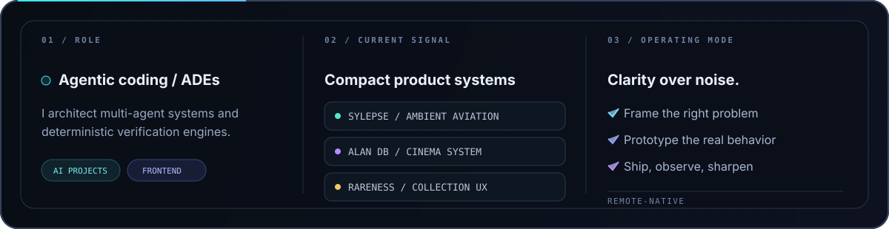
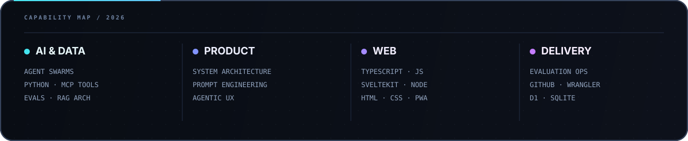

  <picture>
    <source media="(max-width: 680px)" srcset="./assets/profile-hero-mobile.svg?v=2" />
    
  </picture>

   

  <a href="https://github.com/TheoPerson?tab=repositories"><strong>Repositories ↗</strong></a>

 

  <strong>Agentic Systems Architect & Product Builder</strong> bridging the gap between raw LLM capabilities and deterministic, autonomous production pipelines. Specializing in ADE (Agentic Development Environment) orchestration, autonomous QA swarms, and high-signal intelligence infrastructure.

 

<picture>
  <source media="(max-width: 680px)" srcset="./assets/system-overview-mobile.svg" />
  
</picture>

## Selected work

<a href="https://github.com/TheoPerson/Sylepse">
  <picture>
    <source media="(max-width: 680px)" srcset="./assets/project-sylepse-mobile.svg" />
    
  </picture>
</a>

  <a href="https://github.com/TheoPerson/Sylepse">Source</a>

 

<a href="https://github.com/TheoPerson/the-alans-data-base">
  <picture>
    <source media="(max-width: 680px)" srcset="./assets/project-alans-mobile.svg" />
    
  </picture>
</a>

  <a href="https://github.com/TheoPerson/the-alans-data-base"><strong>Source ↗</strong></a>

 

<a href="https://github.com/TheoPerson/Rareness">
  <picture>
    <source media="(max-width: 680px)" srcset="./assets/project-rareness-mobile.svg" />
    
  </picture>
</a>

  <a href="https://github.com/TheoPerson/Rareness">Source</a>

## Operating stack

<picture>
  <source media="(max-width: 680px)" srcset="./assets/toolkit-mobile.svg" />
  
</picture>

 

  <strong>Scaling autonomous architectures?</strong>
    
  <a href="https://github.com/TheoPerson?tab=repositories">Explore the codebase</a>

 

<picture>
  <source media="(max-width: 680px)" srcset="./assets/footer-mobile.svg" />
  
</picture>
